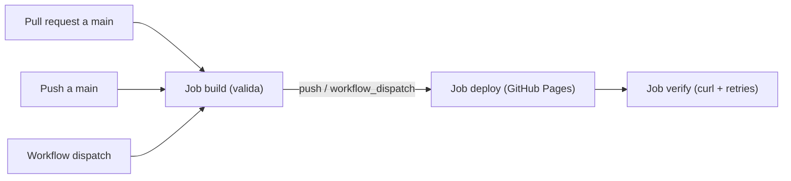

# Portafolio · David Mora

Portafolio digital individual de **David Mora Duque**, estudiante de Ingeniería de Sistemas (UCEVA, actualmente octavo semestre), construido con **Angular** como presentación de su perfil profesional y como **catálogo de cinco proyectos** de desarrollo de software. El objetivo académico es demostrar arquitectura de software, pruebas y despliegue automatizado (CI/CD), no solo el desarrollo de la app.

**Aplicación desplegada:** <https://ingdavidmora2005.github.io/proyecto-portafolio/>


## Funcionalidades

- **Perfil profesional**: identidad, presentación, datos clave, habilidades, idiomas y principios de trabajo.
- **Inicio**: hero con identidad y presentación, cifras calculadas desde los datos reales del catálogo, lista compacta de proyectos y cierre con llamada a contacto.
- **Catálogo de proyectos**: las cinco fichas del portafolio con filtro por categoría.
- **Detalle de proyecto**: información, tecnologías, características y navegación anterior/siguiente.
- **Contacto**: canales de LinkedIn, correo y GitHub, con copia del correo al portapapeles.
- **Página 404**: ruta no encontrada con enlaces de retorno.
- **Tema claro/oscuro** con persistencia en `localStorage` y preferencia del sistema.
- **Accesibilidad**: foco visible, movimiento reducido con `prefers-reduced-motion`, `aria-live` y semántica correcta.

## Stack

- Angular 22 (componentes standalone, sin SSR) con Angular Router y RxJS.
- TypeScript ~6.0.2 y SCSS.
- Vitest 4 con jsdom para pruebas; Prettier para formato.
- Fuentes autoalojadas (Archivo Variable y IBM Plex Mono).

## Estructura del código

```
src/
  app/
    core/       layout (navbar, footer) y servicios (projects, theme)
    features/   inicio, perfil, proyectos, proyecto-detalle, contacto, no-encontrada
    shared/     project-card, section-header, tech-chip
    data/       profile, projects, contact
```

## Puesta en marcha y calidad

```bash
npm ci
npm start
npm test -- --no-watch
npm run build
```

- Pruebas: **69 tests** en **17 archivos** con Vitest (datos, servicios, componentes compartidos y páginas).
- Convenciones: Conventional Commits en español (p. ej. `feat(inicio): construye la pagina de inicio`), ramas por funcionalidad con pull requests.

## Enrutamiento

- Rutas limpias con `PathLocationStrategy` y `routerLink` para navegación interna.
- En el pipeline se copia `index.html` a `404.html` dentro de `dist/proyecto-portafolio/browser/`; GitHub Pages es un servidor estático, así que sin ese truco una recarga de ruta profunda devolvería 404.
- Build con `--base-href /proyecto-portafolio/` para publicar en el subdirectorio.
- Limitación conocida: Pages puede responder HTTP 404 en rutas profundas aunque el navegador muestre la app.

## CI/CD

Flujo del workflow [`deploy.yml`](.github/workflows/deploy.yml):



- **build**: checkout, setup-node (Node 24, caché npm), `npm ci`, `npm test -- --no-watch`, build con `--base-href /proyecto-portafolio/`, copia a `404.html` y validación de artefactos. En `pull_request` solo ejecuta estas validaciones.
- **deploy**: depende de `build`; sólo para `push` o `workflow_dispatch` sobre `main`; despliega con `actions/deploy-pages`; entorno `github-pages`.
- **verify**: depende de `deploy`; con `curl` con reintentos (10 intentos, 15 s) a la URL publicada; verifica respuesta 200, marcador `<app-root` en el HTML, bundle principal y ruta profunda `/perfil` (sin `-f`).

Paso manual: **Settings → Pages → Source = GitHub Actions**.

## Catálogo de proyectos

| Proyecto | Repositorio |
|---|---|
| Portafolio profesional | https://github.com/INGDavidMora2005/proyecto-portafolio |
| Storage Manager | https://github.com/INGDavidMora2005/Project-Store-Manager-Actividad |
| Astro + Angular SSG/SPA | https://github.com/INGDavidMora2005/Taller-4-Astro-Angular-SSG-SPA |
| Clean Architecture Angular | https://github.com/INGDavidMora2005/Uceva-Angular-Taller-Clean-Architecture |
| Pipelines · DevHub | https://github.com/INGDavidMora2005/lab-pipelines-patch |

Para el portafolio, la aplicación está desplegada en <https://ingdavidmora2005.github.io/proyecto-portafolio/>.

## Autor

**David Mora Duque** — [LinkedIn](https://www.linkedin.com/in/david-mora-7a1945434/?lipi=urn%3Ali%3Apage%3Ad_flagship3_profile_view_base_contact_details%3BIViEmqGNTiyWAQXqaiOtdA%3D%3D), [GitHub](https://github.com/INGDavidMora2005), correo: davinchoo2026@gmail.com.
